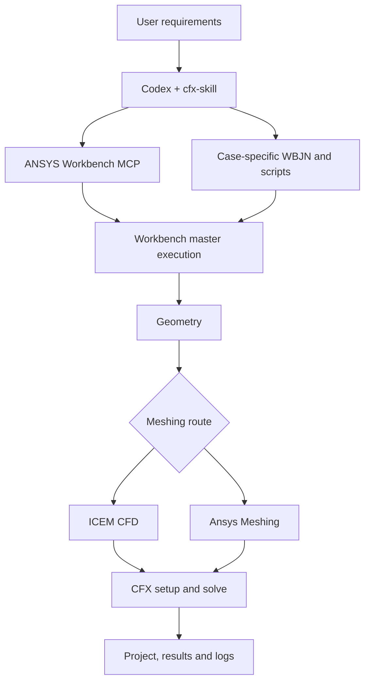
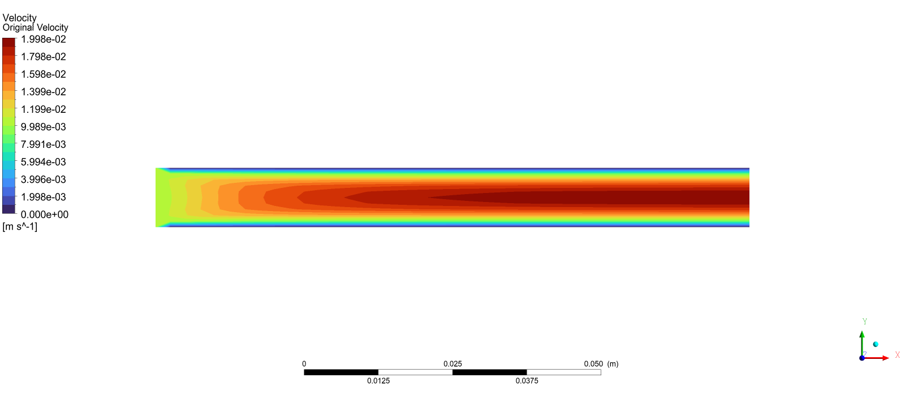
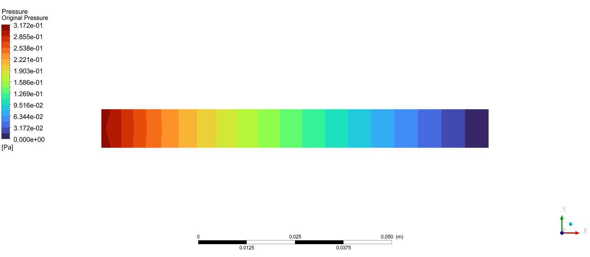

# cfx-skill

<div align="center">

[English](README.en.md) | [简体中文](README.md) | [繁體中文](README.zh-TW.md) | [한국어](README.ko.md) | [日本語](README.ja.md)

</div>


[](LICENSE)
[](https://github.com/hongwenwang36-eng/cfx-skill/stargazers)

Teach Codex to turn your engineering requirements into a **Workbench master `.wbjn` and module scripts**, then use ANSYS Workbench MCP to execute geometry, meshing, CFX solving, and project saving.

Choose **ICEM CFD or Ansys Meshing**, or ask Codex to select a route from the geometry, element type, and layer requirements. The delivery target is a Workbench project that you can reopen to edit the model and inspect results.

## Capabilities

| Stage | Workflow guidance |
| --- | --- |
| Requirements and geometry | Read existing projects or geometry, establish units, regions, materials, boundaries, and acceptance criteria, then write the necessary geometry scripts |
| Meshing | Use ICEM Tcl/Replay or Ansys Meshing Python and verify element types, layers, quality, and boundary names |
| CFX | Generate CFX-Pre sessions and CCL/CEL, solve, and inspect residuals, conservation, and termination |
| Master logic | Write the requested sequence, parameter sweep, conditional control, target search, or numerical iteration |
| Parameter Set | Publish and bind actual parameters, then verify propagation into geometry, mesh, or CFX settings |
| Project delivery | Save `.wbpj`, its companion `_files`, editable scripts, logs, and the corresponding `.res` |
| Result inspection | Let the user inspect contours in CFD-Post by default, extracting scalars when the calculation needs them |

## How the Skill and MCP work together

Codex reads the workflow and generates scripts for the current case. MCP provides execution interfaces to Workbench, ICEM, and CFX. The master journal schedules stages, waits for completion, handles failures, and saves the project. Each module script runs in its application's interpreter.



## Quick start

Use Windows, an ANSYS installation with a valid license, and Codex with local Skill support. Configure the companion MCP project first and confirm that `check_ansys_installation` finds the required applications.[ ANSYS-Workbench-mcp](https://github.com/hongwenwang36-eng/ANSYS-Workbench-mcp)

Clone this repository into the user skill directory listed in the current official documentation.

```powershell
$skillParent = Join-Path $env:USERPROFILE '.agents/skills'
New-Item -ItemType Directory -Force -Path $skillParent | Out-Null
git clone https://github.com/hongwenwang36-eng/cfx-skill.git (Join-Path $skillParent 'cfx-skill')
```

For an existing installation, run `git pull` inside its directory. Codex discovers skill changes automatically. Restart Codex if the skill does not appear. Consult the official documentation for discovery paths.[ Codex Skills](https://learn.chatgpt.com/docs/build-skills)

Then send this request to Codex.

```text
Use $cfx-skill to simulate water flow through a square duct in a new case directory.
Use a 100 mm length and a 10 mm x 10 mm cross-section,
a 0.01 m/s inlet, 0 Pa relative outlet pressure, isothermal steady laminar flow,
and no-slip walls.
Use ICEM CFD to generate 40 x 10 x 10 hexahedral cells.
Write a WBJN master and execute the solve through MCP.
Include an editable ICEM model connected to CFX in the Workbench project.
Deliver the project, companion files, results, scripts, and logs.
```

For Ansys Meshing, request that route and have Codex check sweepability before creating a hex mesh. For custom algorithms, specify inputs, equations or decisions, measured outputs, tolerances, and stopping conditions.

## Validated local case

A square-duct ICEM → Workbench → CFX workflow was executed and rerun on Windows with ANSYS 2025 R1. The integrated project contained an editable ICEM model connected to CFX Setup, and the mesh was opened in ICEM for inspection.

| Item | Configuration or observation |
| --- | --- |
| Duct and fluid | 100 x 10 x 10 mm, constant-property water at 298 K |
| Density and dynamic viscosity | 998 kg/m³, 0.001 Pa·s |
| Inlet and outlet | 0.01 m/s, 0 Pa relative static pressure |
| Mesh | 4,000 hexahedral volume cells |
| ICEM Determinant | All volume cells in the 0.9–1.0 histogram interval |
| RMS residual target | 1e-6 |
| Termination | All targets reached after 35 solver iterations |
| Mass imbalance | Approximately 0.0003% |

These images were exported in CFD-Post from the initial local CFX case at the z = 5 mm midplane. The Workbench ICEM component was subsequently added and its connection and solve were verified again.

**Velocity magnitude in m/s**



**Relative pressure in Pa**



This case validates execution and convergence. Ansys Meshing, Parameter Set sweeps, and custom outer iterations require case-specific validation. Check blocking, interfaces, physics, and mesh accuracy for each new geometry.

## Repository and generated deliverables

```text
cfx-skill/
├── SKILL.md
├── agents/openai.yaml
├── references/
│   ├── ansys-meshing.md
│   ├── icem-cfd.md
│   ├── parameters-and-control.md
│   └── execution.md
├── assets/
│   ├── original_velocity.png
│   └── original_pressure.png
├── README.md
├── README.en.md
├── README.zh-TW.md
├── README.ja.md
├── README.ko.md
└── LICENSE
```

`SKILL.md` and `references/` provide workflow instructions for Codex, currently written in Chinese. Codex writes case-specific scripts in the user's case directory during use. The images illustrate the completed local test.

Generated deliverables typically include a main `.wbpj`, its matching `_files` directory, module scripts, logs, and CFX results. An ICEM workflow should expose an actual editable model component in the project schematic. Keep dependent files together when moving a project.

## Feedback and license

Include your ANSYS version, meshing route, minimal reproduction request, scripts, and sanitized logs when reporting an issue.[ Open an issue](https://github.com/hongwenwang36-eng/cfx-skill/issues)

The repository contents use the MIT license. ANSYS usage remains subject to its software license terms.[ LICENSE](LICENSE)
