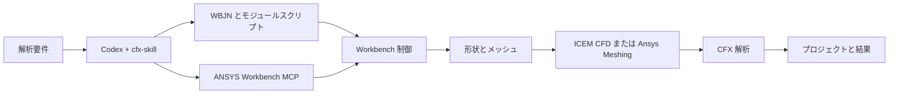

# cfx-skill

<div align="center">

[English](README.en.md) | [简体中文](README.md) | [繁體中文](README.zh-TW.md) | [한국어](README.ko.md) | [日本語](README.ja.md)

</div>


[](LICENSE)
[](https://github.com/hongwenwang36-eng/cfx-skill/stargazers)

工程要件に応じて Codex が **Workbench の制御用 `.wbjn` と各モジュールのスクリプト**を作成し、ANSYS Workbench MCP を通じて形状作成、メッシュ生成、CFX 解析、プロジェクト保存を実行するための Skill です。

**ICEM CFD または Ansys Meshing** を指定できます。形状、要素タイプ、層数の条件から Codex に選択を任せることもできます。再度開いて編集や結果確認ができる Workbench プロジェクトの提供を目指します。

## 機能

| 工程 | Skill が指示する作業 |
| --- | --- |
| 要件と形状 | 既存データを読み、単位、領域、材料、境界条件、完了条件を確認して形状スクリプトを作成 |
| メッシュ | ICEM Tcl/Replay または Ansys Meshing Python を使用し、要素タイプ、層数、品質、境界名を確認 |
| CFX | CFX-Pre セッションと CCL/CEL を作成し、解析後に残差、保存則、終了理由を確認 |
| 制御ロジック | 順次処理、パラメータ走査、条件分岐、目標値探索、数値反復を要件に応じて実装 |
| Parameter Set | パラメータを公開・関連付けし、形状、メッシュ、CFX 設定への反映を確認 |
| 成果物 | `.wbpj`、対応する `_files`、編集可能なスクリプト、ログ、`.res` を保存 |
| 結果確認 | 通常はユーザーが CFD-Post でコンターを確認し、計算に必要なスカラー値を取得 |

## Skill と MCP の連携

Codex が Skill の手順を読み、対象ケースのスクリプトを生成します。MCP は Workbench、ICEM、CFX の実行インターフェースを提供します。制御用ジャーナルが実行順序、待機、エラー処理、保存を担当し、各スクリプトは対応するアプリケーション内で実行されます。



## クイックスタート

Windows、有効なライセンス付きの ANSYS、ローカル Skill に対応した Codex が必要です。先に連携 MCP を設定し、`check_ansys_installation` で必要なプログラムが検出されることを確認してください。[ANSYS-Workbench-mcp](https://github.com/hongwenwang36-eng/ANSYS-Workbench-mcp)

公式ドキュメントに記載されたユーザー用 Skill ディレクトリにクローンします。

```powershell
$skillParent = Join-Path $env:USERPROFILE '.agents/skills'
New-Item -ItemType Directory -Force -Path $skillParent | Out-Null
git clone https://github.com/hongwenwang36-eng/cfx-skill.git (Join-Path $skillParent 'cfx-skill')
```

導入済みの場合はそのディレクトリで `git pull` を実行します。Codex は変更を自動検出します。表示されない場合は再起動してください。検索場所の詳細は公式ドキュメントを参照してください。[Codex Skills](https://learn.chatgpt.com/docs/build-skills)

Codex に次のように依頼します。

```text
$cfx-skill を使用し、新しいケース用フォルダーで正方形断面の直管内の水流を解析してください。
長さ 100 mm、断面 10 mm × 10 mm、入口速度 0.01 m/s、
出口相対圧力 0 Pa、等温・定常・層流、壁面は滑りなしとします。
ICEM CFD で 40 × 10 × 10 の六面体要素を生成してください。
制御用 WBJN を作成し、MCP を通じて解析を実行してください。
Workbench 内に編集可能な ICEM モデルを配置して CFX に接続し、
プロジェクト、関連ファイル、結果、スクリプト、ログを提供してください。
```

Ansys Meshing を利用する場合は明示し、スイープ可能性の確認を求めてください。独自アルゴリズムには入力、式または判定規則、測定する出力、許容誤差、停止条件を指定します。

## 実機検証

Windows と ANSYS 2025 R1 で ICEM → Workbench → CFX の直管ケースを実行し、制御スクリプト全体を再実行しました。編集可能な ICEM モデルを CFX Setup に接続し、ICEM でメッシュを開いて確認しました。

| 項目 | 設定または確認結果 |
| --- | --- |
| 管と流体 | 100 × 10 × 10 mm、物性値一定の水、298 K |
| 密度と粘性係数 | 998 kg/m³、0.001 Pa·s |
| 入口と出口 | 0.01 m/s、相対静圧 0 Pa |
| メッシュ | 六面体体積要素 4,000 個 |
| ICEM Determinant | 全体積要素が 0.9～1.0 の区間 |
| RMS 残差目標 | 1e-6 |
| 解析終了 | ソルバーの 35 回の反復で全目標を達成 |
| 質量不釣り合い | 約 0.0003% |

以下は最初のローカル CFX ケースから CFD-Post で出力した z = 5 mm の中央断面です。その後、Workbench に ICEM コンポーネントを追加し、接続と解析を再検証しました。

**速度の大きさ、単位 m/s**


**相対圧力、単位 Pa**


このケースでは実行経路と収束を確認しました。Ansys Meshing、Parameter Set の走査、独自の外側反復は各ケースで検証が必要です。新しい形状のブロッキング、接続面、物理モデル、メッシュ精度も個別に確認してください。

## ファイル構成と成果物

```text
cfx-skill/
├── SKILL.md
├── agents/openai.yaml
├── references/
│   ├── ansys-meshing.md
│   ├── icem-cfd.md
│   ├── parameters-and-control.md
│   └── execution.md
├── assets/
│   ├── original_velocity.png
│   └── original_pressure.png
├── README.md
├── README.en.md
├── README.zh-TW.md
├── README.ja.md
├── README.ko.md
└── LICENSE
```

`SKILL.md` と `references/` の手順本文は現在中国語です。Codex はユーザーのケース用ディレクトリにスクリプトを生成します。画像は実行済みローカルテストの結果です。

成果物には通常 `.wbpj`、同名の `_files`、スクリプト、ログ、CFX 結果が含まれます。ICEM 経路ではプロジェクト図から開けるモデルを提供します。移動時は依存ファイルも保持してください。

## フィードバックとライセンス

問題を報告する際は ANSYS のバージョン、メッシュ作成ツール、最小再現条件、スクリプト、機密情報を除いたログを添えてください。[Issue を作成](https://github.com/hongwenwang36-eng/cfx-skill/issues)

本リポジトリには MIT ライセンスを適用します。ANSYS の利用には同製品のライセンス条件が適用されます。[LICENSE](LICENSE)
