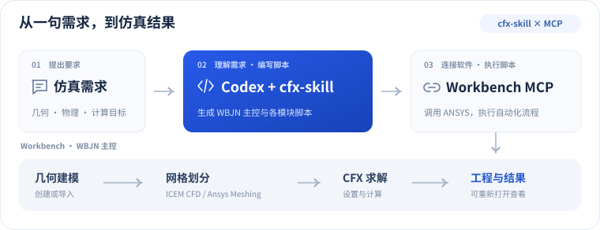
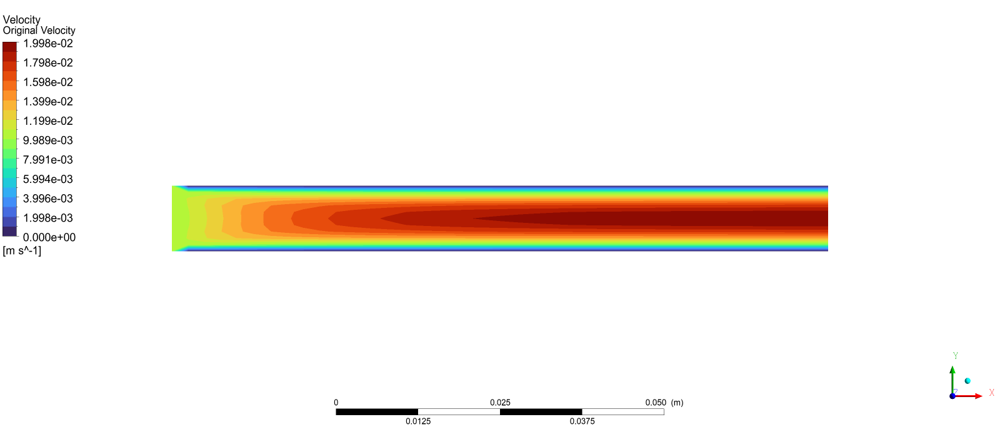
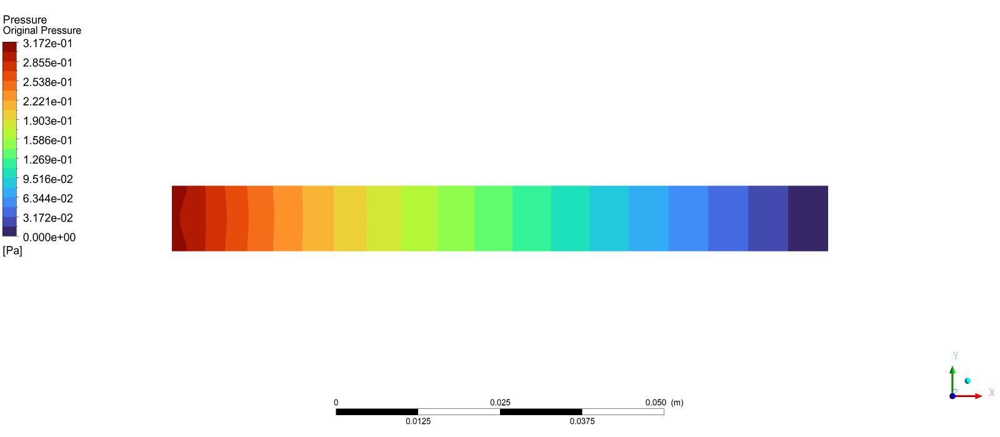

# CFX-skill

[English](README.en.md) | [简体中文](README.md) | [繁體中文](README.zh-TW.md) | [한국어](README.ko.md) | [日本語](README.ja.md)


[](LICENSE)
[](https://github.com/hongwenwang36-eng/CFX-skill/stargazers)

解析の要件を自然言語で伝えると、Codex がスクリプトを作成し、MCP を通じて **ANSYS Workbench + CFX の解析を自動化**します。

## できること

- **形状とメッシュ** — 形状を作成・読み込み、要件に応じて ICEM CFD または Ansys Meshing を使用。
- **CFX 解析** — 材料・境界条件・物理モデル・求解をスクリプトで設定し、結果を確認。
- **制御ロジック** — WBJN でパラメータ走査、条件分岐、数値反復などを実装。
- **パラメータ化** — Workbench Parameter Set と設計点を要件に応じて設定。
- **成果物** — 再度開ける `.wbpj`、関連ファイル、結果とスクリプトを保存し、CFD-Post で確認可能。

## 記述言語

Skill 本体は **Markdown（中国語の指示）+ YAML 設定**で記述しています。Codex は指示を読み、ケースに応じて Workbench WBJN（Python）、ICEM Tcl/Replay、CFX CCL/CEL とセッションスクリプトを生成します。

## 連携の仕組み

Skill が Codex のスクリプト作成を導き、MCP がソフトウェアを呼び出し、WBJN が解析全体を制御します。

<p align="center">
  
</p>

## インストールと使い方

**1. 環境を準備**

Windows に Git、Python 3.10+、Codex を用意し、有効なライセンスを持つ ANSYS Workbench、CFX と、必要な ICEM CFD または Ansys Meshing をインストールします。ANSYS 2025 R1 でケースを検証済みです。

**2. Skill をインストール**

PowerShell で次のコマンドを実行し、ユーザーの Codex スキルディレクトリに配置します。

```powershell
$skillParent = Join-Path $env:USERPROFILE '.agents/skills'
New-Item -ItemType Directory -Force -Path $skillParent | Out-Null
git clone https://github.com/hongwenwang36-eng/CFX-skill.git (Join-Path $skillParent 'cfx-skill')
```

`%USERPROFILE%\.agents\skills\cfx-skill\SKILL.md` が存在することを確認します。Codex は自動検出しますが、表示されない場合は再起動してください。更新時は同じフォルダで `git pull` を実行します。同名 Skill を複数のスキルディレクトリに重複配置しないでください。[公式のスキル配置先](https://learn.chatgpt.com/docs/build-skills)

**3. 連携 MCP を設定**

Skill と MCP は別々にインストールします。[ANSYS-Workbench-mcp](https://github.com/hongwenwang36-eng/ANSYS-Workbench-mcp) が設定済みなら、接続確認に進んでください。

<details>
<summary>MCP の初回設定：コマンドと Codex 設定を表示</summary>

MCP と Python 依存パッケージをインストールし、`%USERPROFILE%\.codex\config.toml` に次の設定を追加します。同名の設定がある場合は既存項目を編集してください。例は D ドライブと ANSYS 2025 R1 を使用しているため、実際のパスに変更してください。

```powershell
git clone https://github.com/hongwenwang36-eng/ANSYS-Workbench-mcp.git D:\ansys-workbench-mcp
py -3 -m venv D:\ansys-workbench-mcp\.venv
& D:\ansys-workbench-mcp\.venv\Scripts\python.exe -m pip install -r D:\ansys-workbench-mcp\requirements.txt
```

```toml
[mcp_servers.ansys-workbench]
command = 'D:\ansys-workbench-mcp\.venv\Scripts\python.exe'
args = ['D:\ansys-workbench-mcp\mcp_server.py']
cwd = 'D:\ansys-workbench-mcp'
startup_timeout_sec = 30
tool_timeout_sec = 600
enabled = true

[mcp_servers.ansys-workbench.env]
ANSYS_WORKBENCH_MCP_HOME = 'D:\ansys-workbench-mcp'
ANSYS_RUNWB2 = 'D:\Program Files\ANSYS Inc\v251\Framework\bin\Win64\RunWB2.exe'
ANSYS_SPACECLAIM = 'D:\Program Files\ANSYS Inc\v251\scdm\SpaceClaim.exe'
ANSYS_CFX_PRE = 'D:\Program Files\ANSYS Inc\v251\CFX\bin\cfx5pre.exe'
ANSYS_CFX_SOLVE = 'D:\Program Files\ANSYS Inc\v251\CFX\bin\cfx5solve.exe'
ANSYS_CFX_POST = 'D:\Program Files\ANSYS Inc\v251\CFX\bin\cfx5post.exe'
ANSYS_ICEM_CFD = 'D:\Program Files\ANSYS Inc\v251\icemcfd\win64_amd\bin\icemcfd.bat'
```

</details>

**4. 接続を確認**

設定を保存して Codex を再起動し、次の要求を送ります。必要なプログラムのパスと Workbench bridge の接続を確認してから解析を実行してください。

```text
check_ansys_installation で ansys-workbench MCP を確認してください。
Workbench、CFX と選択したメッシュツールが使用可能か確認し、
Workbench bridge を起動して接続を確認してください。
```

**5. 解析を開始**

次の要求に形状ファイル、材料、境界条件、メッシュ要件と保存先を添えて Codex に送ります。

```text
$cfx-skill を使って CFX 解析を完了してください。
提供した形状、材料、境界条件とメッシュ要件に基づいてスクリプトを作成し、
MCP で実行して、再度開ける Workbench プロジェクトと解析結果を保存してください。
```

ICEM CFD または Ansys Meshing を指定でき、Parameter Set、パラメータ走査、独自の反復処理も依頼できます。保存された `.wbpj` と同名の `_files` フォルダを保持し、Results から CFD-Post を開いてコンターを確認します。

[MIT License](LICENSE)

## 解析結果

完了した CFX 解析の速度と圧力のコンターを以下に示します。

<p align="center">
  <br />
  
</p>
