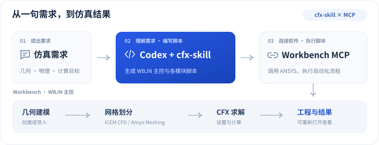
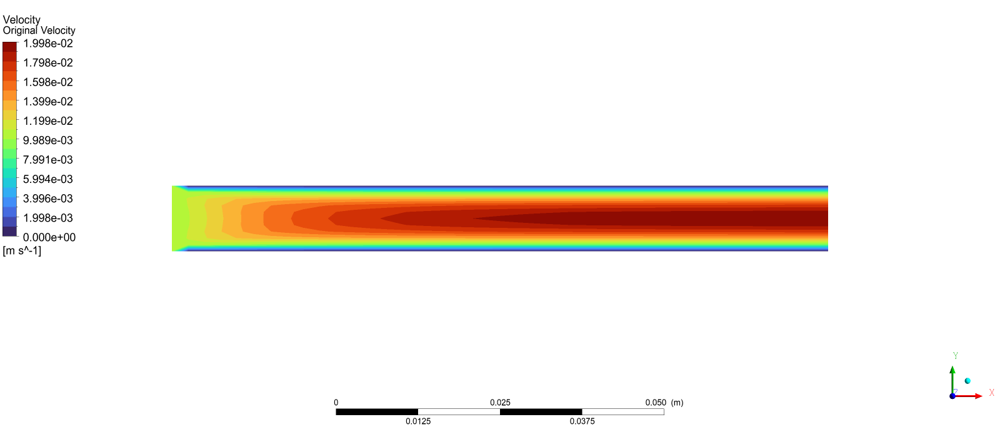
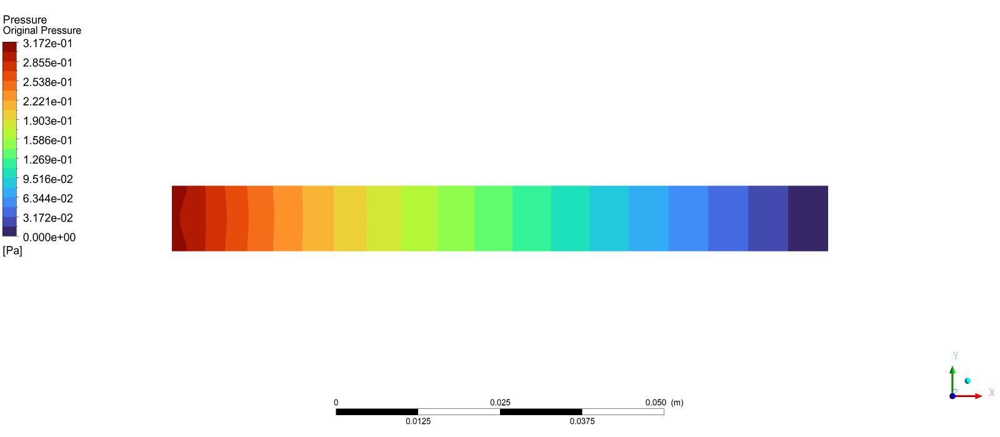

# CFX-skill

[English](README.en.md) | [简体中文](README.md) | [繁體中文](README.zh-TW.md) | [한국어](README.ko.md) | [日本語](README.ja.md)

[](LICENSE)
[](https://github.com/hongwenwang36-eng/cfx-skill/stargazers)

해석 요구사항을 자연어로 전달하면 Codex가 스크립트를 작성하고 MCP를 통해 **ANSYS Workbench + CFX 해석을 자동화**합니다.

## 주요 기능

- **형상과 격자** — 형상을 생성하거나 가져오고, 요구에 따라 ICEM CFD 또는 Ansys Meshing을 사용합니다.
- **CFX 해석** — 재료, 경계 조건, 물리 모델과 해석 실행을 스크립트로 구성하고 결과를 확인합니다.
- **사용자 정의 제어** — WBJN으로 매개변수 스윕, 조건 분기와 수치 반복 등을 구현합니다.
- **매개변수화** — 요구에 맞게 Workbench Parameter Set과 설계점을 구성합니다.
- **프로젝트 제공** — 다시 열 수 있는 `.wbpj`, 관련 파일, 결과와 스크립트를 저장하여 CFD-Post에서 확인할 수 있습니다.

## 연동 방식

Skill은 Codex의 스크립트 작성을 안내하고, MCP는 소프트웨어를 호출하며, WBJN은 전체 해석 흐름을 제어합니다.

<p align="center">
  
</p>

## 설치 및 사용

Windows, 유효한 ANSYS 라이선스, [ANSYS-Workbench-mcp](https://github.com/hongwenwang36-eng/ANSYS-Workbench-mcp)가 설정된 Codex가 필요합니다.

```powershell
$skillParent = Join-Path $env:USERPROFILE '.agents/skills'
New-Item -ItemType Directory -Force -Path $skillParent | Out-Null
git clone https://github.com/hongwenwang36-eng/cfx-skill.git (Join-Path $skillParent 'cfx-skill')
```

설치 후 Codex에 입력

```text
$cfx-skill을 사용해 간단한 덕트의 물 흐름을 해석해 주세요.
ICEM CFD로 격자를 만들고 MCP를 통해 전체 과정을 실행해 주세요.
Workbench에서 열 수 있는 프로젝트와 해석 결과를 저장해 주세요.
```

Ansys Meshing, 매개변수화 또는 사용자 정의 제어 로직도 요청할 수 있습니다. 각 흐름은 해당 해석 사례에서 검증합니다.

[MIT License](LICENSE)

## 해석 결과

사각 덕트 물 흐름 테스트에서 ICEM 격자 생성, Workbench 연동과 CFX 해석을 완료했으며, 아래는 속도 및 압력 등고선입니다.

<p align="center">
  <br />
  
</p>
