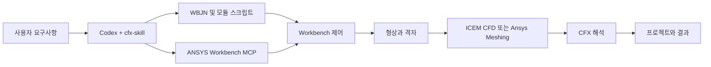

# cfx-skill

<div align="center">

[English](README.en.md) | [简体中文](README.md) | [繁體中文](README.zh-TW.md) | [한국어](README.ko.md) | [日本語](README.ja.md)

</div>


[](LICENSE)
[](https://github.com/hongwenwang36-eng/cfx-skill/stargazers)

공학 요구사항에 맞춰 Codex가 **Workbench 제어용 `.wbjn`과 모듈별 스크립트**를 작성하고, ANSYS Workbench MCP를 통해 형상 생성, 격자 생성, CFX 해석 및 프로젝트 저장을 수행하도록 안내하는 Skill입니다.

**ICEM CFD 또는 Ansys Meshing**을 지정하거나, 형상과 요소 종류 및 층수 조건에 따라 Codex가 선택하도록 요청할 수 있습니다. 다시 열어서 모델을 편집하고 결과를 확인할 수 있는 Workbench 프로젝트를 제공합니다.

## 기능

| 단계 | Skill의 작업 지침 |
| --- | --- |
| 요구사항과 형상 | 기존 프로젝트와 형상을 읽고 단위, 영역, 물성, 경계조건, 완료 기준을 확인한 뒤 형상 스크립트 작성 |
| 격자 | ICEM Tcl/Replay 또는 Ansys Meshing Python을 사용하고 요소 종류, 층수, 품질, 경계 이름 확인 |
| CFX | CFX-Pre 세션과 CCL/CEL을 작성하고 해석 후 잔차, 보존 및 종료 원인 확인 |
| 제어 로직 | 순차 처리, 파라미터 스윕, 조건 분기, 목표값 탐색 또는 수치 반복 구현 |
| Parameter Set | 실제 파라미터를 등록하고 연결하여 형상, 격자 또는 CFX 설정으로 전달되는지 확인 |
| 결과물 | `.wbpj`, 대응하는 `_files`, 편집 가능한 스크립트, 로그 및 `.res` 저장 |
| 결과 확인 | 기본적으로 사용자가 CFD-Post에서 등고선을 확인하고, 계산에 필요한 스칼라 값 추출 |

## Skill과 MCP의 연동

Codex가 Skill의 절차를 읽고 현재 해석에 맞는 스크립트를 생성합니다. MCP는 Workbench, ICEM, CFX의 실행 인터페이스를 제공합니다. 제어 저널은 단계 순서, 완료 대기, 오류 처리와 저장을 담당하며 모듈 스크립트는 각 응용 프로그램에서 실행됩니다.



## 빠른 시작

Windows, 유효한 라이선스가 있는 ANSYS 설치, 로컬 Skill을 지원하는 Codex가 필요합니다. 먼저 연동 MCP를 설정하고 `check_ansys_installation`이 필요한 프로그램을 찾는지 확인하세요.[ANSYS-Workbench-mcp](https://github.com/hongwenwang36-eng/ANSYS-Workbench-mcp)

공식 문서에 안내된 사용자 Skill 디렉터리에 복제합니다.

```powershell
$skillParent = Join-Path $env:USERPROFILE '.agents/skills'
New-Item -ItemType Directory -Force -Path $skillParent | Out-Null
git clone https://github.com/hongwenwang36-eng/cfx-skill.git (Join-Path $skillParent 'cfx-skill')
```

이미 설치했다면 해당 디렉터리에서 `git pull`을 실행하세요. Codex는 변경을 자동으로 감지합니다. 표시되지 않으면 Codex를 다시 시작하세요. 검색 경로는 공식 문서를 참고하세요.[Codex Skills](https://learn.chatgpt.com/docs/build-skills)

Codex에 다음과 같이 요청할 수 있습니다.

```text
$cfx-skill을 사용해 새 해석 폴더에서 정사각형 단면 직관의 물 흐름을 해석해 주세요.
길이 100 mm, 단면 10 mm × 10 mm, 입구 속도 0.01 m/s,
출구 상대압력 0 Pa, 등온 정상 층류와 점착 벽면 조건을 사용하세요.
ICEM CFD로 40 × 10 × 10개의 육면체 요소를 생성하세요.
제어용 WBJN을 작성하고 MCP를 통해 해석을 실행하세요.
Workbench에 편집 가능한 ICEM 모델을 포함해 CFX와 연결하고,
프로젝트, 관련 파일, 결과, 스크립트, 로그를 제공하세요.
```

Ansys Meshing을 사용하려면 도구를 명시하고 형상의 스윕 가능성 확인을 요청하세요. 사용자 정의 알고리즘에는 입력, 수식 또는 판정 규칙, 측정할 출력, 허용오차와 종료 조건을 지정하세요.

## 실제 검증

Windows와 ANSYS 2025 R1에서 직관의 ICEM → Workbench → CFX 흐름을 실행하고 전체 제어 스크립트를 다시 실행했습니다. 편집 가능한 ICEM 모델을 CFX Setup에 연결하고 ICEM에서 격자를 열어 확인했습니다.

| 항목 | 설정 또는 관찰 결과 |
| --- | --- |
| 관과 유체 | 100 × 10 × 10 mm, 일정 물성의 물, 298 K |
| 밀도와 점성계수 | 998 kg/m³, 0.001 Pa·s |
| 입구와 출구 | 0.01 m/s, 상대 정압 0 Pa |
| 격자 | 육면체 체적 요소 4,000개 |
| ICEM Determinant | 모든 체적 요소가 0.9～1.0 구간에 포함 |
| RMS 잔차 목표 | 1e-6 |
| 해석 종료 | 솔버 내부 반복 35회 후 모든 목표 달성 |
| 질량 불균형 | 약 0.0003% |

아래 그림은 초기 로컬 CFX 해석 결과의 z = 5 mm 중앙 단면을 CFD-Post로 내보낸 것입니다. 이후 Workbench에 ICEM 구성요소를 추가하고 연결과 해석을 다시 검증했습니다.

**속도 크기, 단위 m/s**


**상대압력, 단위 Pa**


이 사례는 실행 흐름과 수렴을 검증합니다. Ansys Meshing, Parameter Set 스윕, 사용자 정의 외부 반복은 사례별 검증이 필요합니다. 새 형상의 블로킹, 인터페이스, 물리 모델과 격자 정확도도 개별적으로 확인해야 합니다.

## 저장소 구성과 결과물

```text
cfx-skill/
├── SKILL.md
├── agents/openai.yaml
├── references/
│   ├── ansys-meshing.md
│   ├── icem-cfd.md
│   ├── parameters-and-control.md
│   └── execution.md
├── assets/
│   ├── original_velocity.png
│   └── original_pressure.png
├── README.md
├── README.en.md
├── README.zh-TW.md
├── README.ja.md
├── README.ko.md
└── LICENSE
```

`SKILL.md`와 `references/`의 지침 본문은 현재 중국어입니다. Codex는 사용자 해석 디렉터리에 구체적인 스크립트를 작성합니다. 이미지는 완료된 로컬 테스트를 보여 줍니다.

결과물에는 일반적으로 `.wbpj`, 같은 이름의 `_files`, 스크립트, 로그와 CFX 결과가 포함됩니다. ICEM 경로에서는 프로젝트 구성도에서 열 수 있는 실제 모델 구성요소를 제공합니다. 이동할 때 관련 파일을 함께 보관하세요.

## 피드백과 라이선스

문제 보고 시 ANSYS 버전, 격자 도구, 최소 재현 요청, 스크립트와 민감 정보를 제거한 로그를 포함해 주세요.[Issue 작성](https://github.com/hongwenwang36-eng/cfx-skill/issues)

저장소 내용은 MIT 라이선스를 따릅니다. ANSYS 사용에는 해당 소프트웨어의 라이선스 조건이 적용됩니다.[LICENSE](LICENSE)
