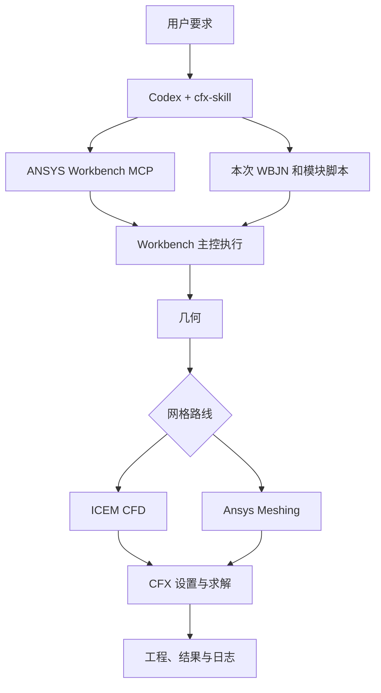

# CFX-skill

<div align="center">

[English](README.en.md) | [简体中文](README.md) | [繁體中文](README.zh-TW.md) | [한국어](README.ko.md) | [日本語](README.ja.md)

</div>


[](LICENSE)
[](https://github.com/hongwenwang36-eng/cfx-skill/stargazers)

让 Codex 根据你的工程要求编写 **Workbench 主控 `.wbjn` 和各模块脚本**，结合 ANSYS Workbench MCP 完成几何、划网格、CFX 求解和工程保存。

支持用户指定 **ICEM CFD 或 Ansys Meshing**，也支持由 Codex 根据几何、单元类型和层数要求选择路线。最终交付可重新打开的 Workbench 工程，便于继续编辑并查看结果。

## 能做什么

| 环节 | Skill 中的工作要求 |
| --- | --- |
| 需求与几何 | 读取现有工程或几何，明确单位、区域、材料、边界条件和验收目标，编写所需几何脚本 |
| 网格 | 按要求选择 ICEM Tcl/Replay 或 Ansys Meshing Python，检查单元类型、层数、质量和边界名称 |
| CFX | 编写 CFX-Pre 会话、CCL/CEL，运行求解，检查残差、守恒和终止原因 |
| 主控逻辑 | 按本次要求编写顺序流程、参数扫描、条件判断、目标搜索或数值迭代 |
| Parameter Set | 发布和绑定实际参数，验证参数变化传递到几何、网格或 CFX 设置 |
| 工程交付 | 保存 `.wbpj` 与配套 `_files`，保留可编辑脚本、日志和对应 `.res` |
| 结果查看 | 默认由用户打开 CFD-Post 查看云图，计算闭环按需要提取标量 |

## Skill 与 MCP 如何配合

Codex 读取 Skill 的流程要求，生成本次算例的具体脚本。MCP 提供 Workbench、ICEM 和 CFX 的执行接口。Workbench 主控负责安排阶段、等待执行、处理失败和保存工程。模块脚本在各自应用的解释器中运行。



## 快速开始

需要 Windows、已安装并具备有效许可的 ANSYS，以及能够使用本地 Skill 的 Codex。先按配套项目的说明配置 MCP，确认 `check_ansys_installation` 能找到所需程序。[ANSYS-Workbench-mcp](https://github.com/hongwenwang36-eng/ANSYS-Workbench-mcp)

将本仓库安装到当前官方文档列出的用户技能目录。

```powershell
$skillParent = Join-Path $env:USERPROFILE '.agents/skills'
New-Item -ItemType Directory -Force -Path $skillParent | Out-Null
git clone https://github.com/hongwenwang36-eng/cfx-skill.git (Join-Path $skillParent 'cfx-skill')
```

已有该目录时，在现有副本中运行 `git pull`。Codex 会自动发现技能更新，若技能列表没有出现，重启 Codex。安装目录与发现规则可查阅官方说明。[Codex Skill 文档](https://learn.chatgpt.com/docs/build-skills)

然后在 Codex 中输入以下请求。

```text
使用 $cfx-skill，在新建算例目录中完成一个方形直管的水流仿真。
管长 100 mm，截面 10 mm × 10 mm，入口速度 0.01 m/s，
出口相对压力 0 Pa，等温稳态层流，四壁无滑移。
使用 ICEM CFD，划分 40 × 10 × 10 个六面体单元。
编写 WBJN 主控并通过 MCP 完成求解。
在 Workbench 工程中保留可打开的 ICEM 模型并连接 CFX，
交付工程、配套文件、结果、脚本和日志。
```

指定 Ansys Meshing 时，可将网格要求替换为“使用 Ansys Meshing，检查几何可扫掠性后生成六面体网格”。需要自定义算法时，提供输入、公式或判定规则、读取的输出量、容差和停止条件。

## 实机测试

在 Windows 与 ANSYS 2025 R1 上完成了方形直管的 ICEM → Workbench → CFX 测试，并完整复跑主控。工程中包含可编辑的 ICEM 模型及到 CFX Setup 的连接，实际打开 ICEM 检查了网格。

| 项目 | 实测或设置 |
| --- | --- |
| 管道与流体 | 100 × 10 × 10 mm，定物性水，298 K |
| 密度与动力黏度 | 998 kg/m³，0.001 Pa·s |
| 入口与出口 | 0.01 m/s，0 Pa 相对静压 |
| 网格 | 4,000 个六面体体单元 |
| ICEM Determinant | 全部体单元落在 0.9～1.0 区间 |
| RMS 残差目标 | 1e-6 |
| 求解终止 | 35 次内部迭代后达到全部目标 |
| 质量不平衡 | 约 0.0003% |

下面两张图取自本地测试中最初的 CFX 算例结果，在 z = 5 mm 中央截面由 CFD-Post 导出。之后增加 Workbench 内的 ICEM 组件并重新验证连接与求解。

**速度大小，单位 m/s**


**相对压力，单位 Pa**


此算例验证了流程连通与求解收敛。Ansys Meshing、Parameter Set 扫描和自定义外层迭代仍需在具体算例中验证。新几何的 Blocking、接口、物理模型和网格精度需逐例检查。

## 仓库内容与交付文件

```text
cfx-skill/
├── SKILL.md
├── agents/openai.yaml
├── references/
│   ├── ansys-meshing.md
│   ├── icem-cfd.md
│   ├── parameters-and-control.md
│   └── execution.md
├── assets/
│   ├── original_velocity.png
│   └── original_pressure.png
├── README.md
├── README.en.md
├── README.zh-TW.md
├── README.ja.md
├── README.ko.md
└── LICENSE
```

`SKILL.md` 和 `references/` 为 Codex 提供流程指导，当前正文使用中文。每次使用时，由 Codex 在用户算例目录中编写具体脚本。仓库中的图片用于展示已完成的本地测试。

生成的工程通常包括主 `.wbpj`、同名 `_files` 目录、模块源脚本、日志和 CFX 结果。ICEM 路线应在工程图中提供实际可打开的模型组件。移动工程时一起保留其依赖文件。

## 反馈与许可

反馈问题时，请提供 ANSYS 版本、网格路线、最小复现要求、脚本与脱敏日志。[提交 Issue](https://github.com/hongwenwang36-eng/cfx-skill/issues)

MIT 许可覆盖本仓库内容。使用 ANSYS 需遵守其软件许可条款。[LICENSE](LICENSE)
