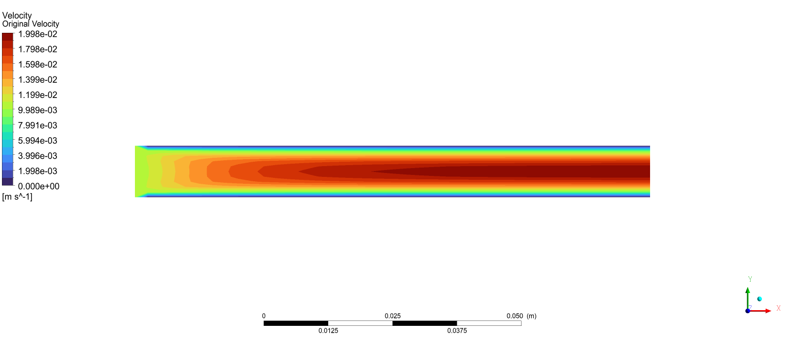
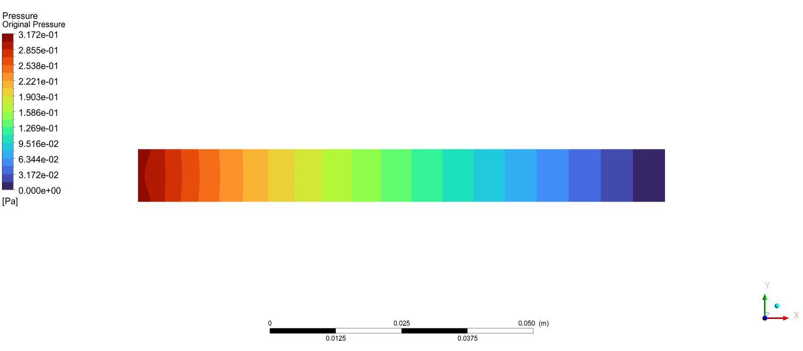

# CFX-skill

[English](README.en.md) | [简体中文](README.md) | [繁體中文](README.zh-TW.md) | [한국어](README.ko.md) | [日本語](README.ja.md)

[](LICENSE)
[](https://github.com/hongwenwang36-eng/cfx-skill/stargazers)

用自然语言描述仿真需求，让 Codex 编写脚本，通过 MCP 自动完成 **ANSYS Workbench + CFX 仿真**。

## 能做什么

- **几何与网格** — 创建或导入几何，按要求使用 ICEM CFD 或 Ansys Meshing。
- **CFX 求解** — 编写设置与求解脚本，配置材料、边界条件和物理模型，检查求解结果。
- **自定义控制** — 编写 WBJN 主控，支持参数扫描、条件判断、数值迭代等计算逻辑。
- **参数化** — 按需求配置 Workbench Parameter Set 和设计点。
- **工程交付** — 保存可重新打开的 `.wbpj`、配套文件、结果与脚本，便于自行打开 CFD-Post 查看云图。

## 如何配合

Skill 指导 Codex 编写脚本，MCP 负责调用软件，WBJN 串联整个仿真流程。

## 安装与使用

需要 Windows、有效的 ANSYS 许可，以及已配置 [ANSYS-Workbench-mcp](https://github.com/hongwenwang36-eng/ANSYS-Workbench-mcp) 的 Codex。

```powershell
$skillParent = Join-Path $env:USERPROFILE '.agents/skills'
New-Item -ItemType Directory -Force -Path $skillParent | Out-Null
git clone https://github.com/hongwenwang36-eng/cfx-skill.git (Join-Path $skillParent 'cfx-skill')
```

安装后在 Codex 中输入

```text
使用 $cfx-skill，完成一个简单的管道水流仿真。
使用 ICEM CFD 划分网格，通过 MCP 执行整个流程，
交付可以在 Workbench 中打开的工程及求解结果。
```

也可以指定 Ansys Meshing，或提出参数化、自定义控制逻辑等要求；具体流程按算例验证。

[MIT License](LICENSE)

## 结果展示

方管水流测试已完成 ICEM 网格、Workbench 集成与 CFX 求解，以下为速度与压力云图。

<p align="center">
  <br />
  
</p>
