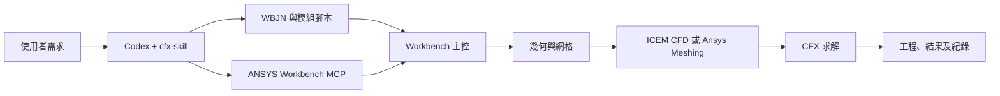
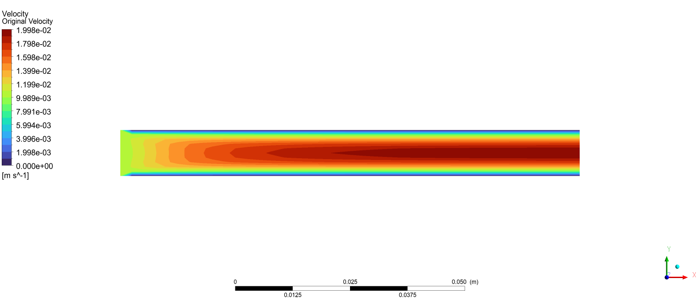
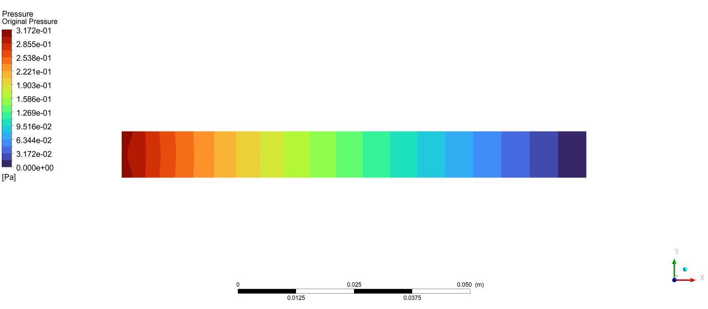

# cfx-skill

<div align="center">

[English](README.en.md) | [简体中文](README.md) | [繁體中文](README.zh-TW.md) | [한국어](README.ko.md) | [日本語](README.ja.md)

</div>


[](LICENSE)
[](https://github.com/hongwenwang36-eng/cfx-skill/stargazers)

讓 Codex 依照你的工程需求編寫 **Workbench 主控 `.wbjn` 與各模組腳本**，配合 ANSYS Workbench MCP 完成幾何、網格劃分、CFX 求解及工程儲存。

可指定 **ICEM CFD 或 Ansys Meshing**，也可讓 Codex 依幾何、元素類型與層數需求選擇。交付目標是能重新開啟、繼續編輯與查看結果的 Workbench 工程。

## 功能

| 環節 | Skill 的工作要求 |
| --- | --- |
| 需求與幾何 | 讀取既有工程或幾何，確認單位、區域、材料、邊界條件與驗收目標，編寫所需幾何腳本 |
| 網格 | 使用 ICEM Tcl/Replay 或 Ansys Meshing Python，檢查元素類型、層數、品質與邊界名稱 |
| CFX | 編寫 CFX-Pre 會話及 CCL/CEL，求解並檢查殘差、守恆與終止原因 |
| 主控邏輯 | 依需求編寫順序流程、參數掃描、條件判斷、目標搜尋或數值迭代 |
| Parameter Set | 發布並綁定實際參數，驗證變動能傳遞至幾何、網格或 CFX 設定 |
| 工程交付 | 儲存 `.wbpj` 與配套 `_files`，保留可編輯腳本、紀錄及對應 `.res` |
| 結果檢視 | 預設由使用者開啟 CFD-Post 查看雲圖，計算流程依需求擷取純量 |

## Skill 與 MCP 的配合

Codex 讀取流程要求並產生本次算例腳本，MCP 提供 Workbench、ICEM 與 CFX 的執行介面。Workbench 主控安排階段、等待完成、處理失敗及儲存工程，各模組腳本由所屬應用程式執行。



## 快速開始

需要 Windows、已安裝且具有效授權的 ANSYS，以及支援本機 Skill 的 Codex。先依配套專案設定 MCP，確認 `check_ansys_installation` 能找到所需程式。[ANSYS-Workbench-mcp](https://github.com/hongwenwang36-eng/ANSYS-Workbench-mcp)

將本儲存庫安裝至目前官方文件列出的使用者技能目錄。

```powershell
$skillParent = Join-Path $env:USERPROFILE '.agents/skills'
New-Item -ItemType Directory -Force -Path $skillParent | Out-Null
git clone https://github.com/hongwenwang36-eng/cfx-skill.git (Join-Path $skillParent 'cfx-skill')
```

若目錄已存在，在既有副本執行 `git pull`。Codex 會自動偵測技能更新，若未顯示請重新啟動。發現規則與目錄詳見官方文件。[Codex Skill 文件](https://learn.chatgpt.com/docs/build-skills)

接著向 Codex 提出以下要求。

```text
使用 $cfx-skill，在新的算例目錄模擬方形直管水流。
長度 100 mm，截面 10 mm × 10 mm，入口速度 0.01 m/s，
出口相對壓力 0 Pa，等溫穩態層流，四壁無滑移。
使用 ICEM CFD 劃分 40 × 10 × 10 個六面體元素。
編寫 WBJN 主控並透過 MCP 完成求解。
在 Workbench 工程中保留可開啟的 ICEM 模型並連接 CFX，
交付工程、配套檔案、結果、腳本及紀錄。
```

使用 Ansys Meshing 時，指定工具並要求先檢查幾何的可掃掠性。自訂演算法需提供輸入、公式或判斷規則、輸出量、容許誤差與停止條件。

## 實機驗證

已在 Windows 與 ANSYS 2025 R1 完成方形直管的 ICEM → Workbench → CFX 流程並完整重跑主控。工程包含可編輯 ICEM 模型及到 CFX Setup 的連線，已實際開啟 ICEM 檢查網格。

| 項目 | 設定或觀察 |
| --- | --- |
| 管道與流體 | 100 × 10 × 10 mm，定物性水，298 K |
| 密度與動力黏度 | 998 kg/m³，0.001 Pa·s |
| 入口與出口 | 0.01 m/s，0 Pa 相對靜壓 |
| 網格 | 4,000 個六面體體元素 |
| ICEM Determinant | 全部體元素位於 0.9～1.0 區間 |
| RMS 殘差目標 | 1e-6 |
| 求解終止 | 35 次內部迭代後達到全部目標 |
| 質量不平衡 | 約 0.0003% |

下圖由本機測試最初的 CFX 算例，在 z = 5 mm 中央截面由 CFD-Post 匯出。之後新增 Workbench ICEM 元件並再次驗證連線及求解。

**速度大小，單位 m/s**



**相對壓力，單位 Pa**



此算例驗證流程與收斂。Ansys Meshing、Parameter Set 掃描和自訂外層迭代仍需逐例驗證。新幾何的分塊、介面、物理模型及網格精度需另行檢查。

## 檔案與交付內容

```text
cfx-skill/
├── SKILL.md
├── agents/openai.yaml
├── references/
│   ├── ansys-meshing.md
│   ├── icem-cfd.md
│   ├── parameters-and-control.md
│   └── execution.md
├── assets/
│   ├── original_velocity.png
│   └── original_pressure.png
├── README.md
├── README.en.md
├── README.zh-TW.md
├── README.ja.md
├── README.ko.md
└── LICENSE
```

`SKILL.md` 與 `references/` 提供 Codex 流程指引，目前正文使用中文。Codex 在使用者的算例目錄編寫具體腳本，圖片展示已完成的本機測試。

交付通常包含 `.wbpj`、同名 `_files`、模組腳本、紀錄與 CFX 結果。ICEM 路線應在工程圖中提供可開啟的模型元件。移動工程時須保留依賴檔案。

## 回饋與授權

回報時請提供 ANSYS 版本、網格工具、最小重現要求、腳本與去識別化紀錄。[提交 Issue](https://github.com/hongwenwang36-eng/cfx-skill/issues)

本儲存庫採用 MIT 授權。使用 ANSYS 須遵守其軟體授權條款。[LICENSE](LICENSE)
